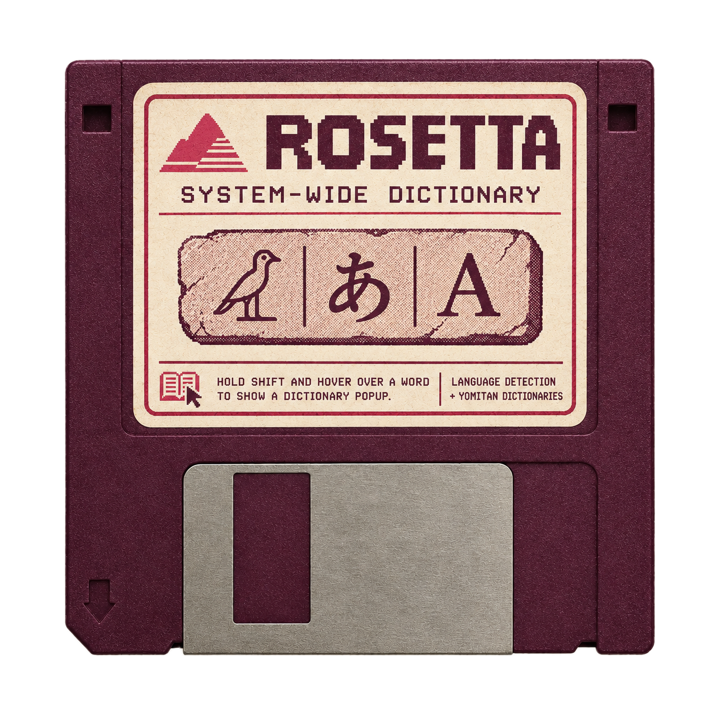

<p align="center">
  
</p>

A system-wide pop-up dictionary for Windows. Hold Shift, hover a word in a native desktop app, and see a Yomitan-style dictionary popup — the same experience Yomitan gives you in the browser.

First targets: Microsoft Word (desktop), Microsoft Teams (new desktop client) and PDF viewers. Japanese, English and Spanish work from day one, and the language is picked automatically from the text under the cursor.

> **Status:** first semi-functional prototype.

## How it works

1. While Shift is held, Rosetta watches the pointer (it never consumes any key).
2. After the cursor rests briefly, it reads about 20 characters at the cursor through Windows UI Automation.
3. A language detector picks the matching Yomitan profile.
4. The local Yomitan API returns the entries and rendered HTML.
5. A non-focus-stealing WebView2 popup shows the result next to the word.

Rosetta reads real on-screen text. It is not an OCR tool for games, images or video.

> **Online feature:** selected-text translation is the one part that is **not local**: it sends the text you select to Google Translate when you hold Ctrl over it. You can untick it in the installer or switch it off from the tray at any time. See [Online translation](#online-translation-not-local).

> **Important:** Rosetta does not contain a dictionary. Lookups are answered by the Yomitan extension running inside **Microsoft Edge**, so Edge must be open whenever you use Rosetta (see below).

## Install

Installing takes three parts, in this order:

| Part | What | Where |
| --- | --- | --- |
| **A** | Build the installer (once, or download it from whoever shared it) | [A. Build the installer](#a-build-the-installer) |
| **B** | Run the installer | [B. Run the installer](#b-run-the-installer) |
| **C** | Set up Edge and Yomitan (the dictionary behind Rosetta) | [Setting up Edge](#setting-up-edge) below |

Rosetta will not show any popup until **part C** is done.

### A. Build the installer

Skip this if someone already gave you `Rosetta-Setup.exe`.

1. Install the [.NET 10 SDK](https://dotnet.microsoft.com/download) and [Inno Setup 6](https://jrsoftware.org/isinfo.php). In PowerShell, Inno Setup is one line:
   ```powershell
   winget install JRSoftware.InnoSetup
   ```
2. Open **PowerShell** in the Rosetta folder. Easiest way: open the folder in File Explorer, click an empty spot in the address bar, type `powershell` and press Enter.
3. Run:
   ```powershell
   powershell -ExecutionPolicy Bypass -File installeruild.ps1
   ```
   It takes about a minute. It publishes the app, then compiles the installer. The last line printed should be:
   ```
   Built S:\...\Rosetta\installer\Output\Rosetta-Setup.exe
   ```
4. **The installer is the file `installer\Output\Rosetta-Setup.exe`** inside the Rosetta folder (about 38 MB). Open the folder from PowerShell with:
   ```powershell
   explorer installer\Output
   ```

### B. Run the installer

1. Double-click `Rosetta-Setup.exe`. No admin rights are needed. If Windows SmartScreen warns about an unknown publisher, click **More info > Run anyway** (the installer is not code-signed).
2. The first page after the welcome screen is a notice that **translation is not local**. Read it, then click **Next** through the pages.
3. On the *Select Additional Tasks* page, **Enable ONLINE translation** is **ticked** by default and **Start Rosetta when I sign in to Windows** is **unticked**. Untick the translation box if you do not want selected text ever sent to Google; tick the start-up box if you want Rosetta to launch with Windows.
4. Click **Finish** with **Launch Rosetta** ticked.
5. Find Rosetta in the notification area: click the **^** (*Show hidden icons*) arrow next to the clock. You should see the Rosetta crystal icon.
   - **Right-click** it for the menu: **Enabled** (on/off), **Translate selection (online)** (on/off), **Translate to** (English, Japanese or Spanish), **Start with Windows**, **Exit**.
   - **Double-click** it to switch Rosetta on or off quickly. The tooltip says which state it is in.
   - To keep the icon always visible, drag it from the overflow onto the taskbar, or use *Settings > Personalization > Taskbar > Other system tray icons*.

Rosetta installs to `%LOCALAPPDATA%\Programs\Rosetta` and has a Start menu entry. Only one copy runs at a time. To remove it, use *Settings > Apps > Installed apps > Rosetta > Uninstall*.

### C. Set up Edge

Follow [Setting up Edge](#setting-up-edge) below, then keep Edge open whenever you use Rosetta.

## Setting up Edge

Rosetta talks to Yomitan through a small local API that only exists while Edge is running with the extension. Do this once. Total time is about 15 minutes.

You will need **Microsoft Edge** (already part of Windows 10/11), **[Python](https://www.python.org/downloads/)**, **[Node.js](https://nodejs.org/)** and **[Git](https://git-scm.com/)**.

### Step 1: Install Python (with PATH)

1. Download the installer from python.org and run it.
2. On the **first page** of the installer, tick **Add python.exe to PATH** (bottom of the window), then click **Install Now**.
3. Check it: open the Start menu, type `cmd`, press Enter, type `python --version` and press Enter. A version number should appear.

### Step 2: Get the patched Yomitan

Rosetta needs a Yomitan build with the `profileIndex` patch, which the Edge Add-ons store version does not have. Build it once (details in [Patched backend](#patched-backend)):

1. Open a terminal in the folder where you keep Rosetta's `tools` folder.
2. Run these commands:
   ```
   git clone --branch 26.9.8.0 --depth 1 https://github.com/yomidevs/yomitan.git tools/yomitan
   cd tools/yomitan
   git apply ../../patches/yomitan-profileIndex.diff
   npm ci
   npm run build -- --target edge
   ```
3. This creates `tools/yomitan/builds/yomitan-edge.zip`. Extract it into a new folder `tools/yomitan-patched` (right-click the zip > *Extract All...* > pick that folder). You should see `manifest.json` directly inside `tools/yomitan-patched`.
4. **Do not move or rename `tools/yomitan-patched` afterwards.** The extension's ID is derived from its location, and moving it changes the ID (you would have to redo Step 5).

### Step 3: Load it into Edge

1. Open Edge and type `edge://extensions` in the address bar, then press Enter.
2. In the **left sidebar**, switch on **Developer mode**.
3. Click **Load unpacked** (top of the page).
4. In the folder dialog, select `tools/yomitan-patched` (the folder that contains `manifest.json`) and click **Select Folder**.
5. *Yomitan Popup Dictionary* appears in the list. If you also installed Yomitan from the Edge store, **turn that copy off** so only the patched one runs.

### Step 4: Copy your extension ID

Because you loaded Yomitan from a folder instead of the store, it has its **own special extension ID**, and the API needs to be told about it. Without this, Edge refuses to let Yomitan talk to the API.

1. On `edge://extensions`, find Yomitan and click **Details**.
2. Under the name, find **ID** (a 32-letter string such as `mbclianmdhnmblbfecpefmgjhajbioip`) and copy it.
3. Build the value you will paste in Step 5 by adding a prefix and a trailing slash:
   ```
   chrome-extension://<your 32-letter ID>/
   ```
   For example: `chrome-extension://mbclianmdhnmblbfecpefmgjhajbioip/`. Edge's settings page URL starts with `extension://`; that is **wrong** for this purpose. It must say `chrome-extension://`, and the final `/` is required.

### Step 5: Register the native-messaging host

1. Download [yomitan-api](https://github.com/yomidevs/yomitan-api/archive/master.zip) and extract it to a simple path such as `C:\yomitan-api` (no unicode or special characters in the path).
2. Open a terminal in that folder (in File Explorer, click the address bar, type `cmd`, press Enter).
3. Run `python install_yomitan_api.py`.
4. At **Choose browser:** type the number next to `edge` and press Enter.
5. At **Extension ID:** paste the `chrome-extension://.../` value from Step 4 and press Enter.
6. At the next **Extension ID:** prompt, press Enter on an empty line to finish. If no errors are shown, it worked.

### Step 6: Turn the API on in Yomitan

1. In Edge, click the puzzle-piece **Extensions** button in the toolbar, then click **Yomitan**'s icon. In the pop-up, click the **cog** (Settings). The settings page opens.
2. In the **bottom-left corner**, switch on **Advanced** (the toggle switch). More options appear.
3. Open the **General** page in the left menu.
4. Switch on **Enable Yomitan API**.
5. Click **More...** below it, then **Test**. Wait a few seconds after enabling the setting. A success message means the native host is working.

### Step 7: Create the three profiles

In the same Yomitan settings page, open **Profiles** in the left menu. Rosetta picks languages **by position**, so the order matters:

1. Profile **0**: language **Japanese**, with your Japanese dictionaries enabled.
2. Profile **1**: language **English**, with your English dictionaries enabled.
3. Profile **2**: language **Spanish**, with your Spanish dictionaries enabled.

To add one: click **Add profile**, name it, open **Languages** (General) and choose its language, then import and enable its dictionaries under **Dictionaries**.

### Step 8: Restart Edge completely

Close **every** Edge window (check the system tray too), then open Edge again. Edge only reads native-host registrations at startup, so the API stays silent until you do. Leave Edge open afterwards.

### Step 9: Check it

With Edge open, run in a terminal:

```
curl -s -X POST http://127.0.0.1:19633/termEntries -d "{\"term\":\"corriendo\",\"profileIndex\":2}"
```

You should get a response containing "correr". Then start Rosetta, hold Shift over a word in Word, and the popup should appear.

### Edge must stay open

Keep Edge running (minimised is fine) every time you want Rosetta to work. If Edge is closed, Rosetta shows *"Yomitan API is not responding"*.

### Using another browser as your main one

You can keep browsing in Chrome, Firefox or anything else, with Yomitan installed there as usual. The recommended setup is:

- **Edge** stays open in the background, with the patched Yomitan, as Rosetta's lookup engine.
- **Your main browser** keeps its own Yomitan extension for pop-ups on web pages.

Rosetta is for native apps (Word, Teams, PDF viewers); it never needs your main browser.

### Troubleshooting

| Symptom | Likely cause |
| --- | --- |
| "Yomitan API is not responding" | Edge is closed, *Enable Yomitan API* is off, the native host is not registered, or Edge was not restarted after registering it |
| "the profileIndex patch is not live" | Edge is running the stock Yomitan; reload the unpacked build from `tools/yomitan-patched` |
| Wrong language for a word | Profiles are not in the order Japanese, English, Spanish |
| Nothing happens on Shift | Rosetta is switched off in the tray menu |
| Ctrl over a selection does nothing | **Translate selection (online)** is off in the tray menu, or the pointer is not on the selected text |
| "Translation unavailable" | No internet, or Google is limiting requests; wait a moment and try again |

## Online translation (not local)

> **Reminder: translation is not local.** Everything else in Rosetta runs on your PC, but translation sends the text you select over the internet to **Google Translate**. It needs a connection, Google receives the text, and it should not be used on confidential or private text. Nothing is sent unless you hold **Ctrl** over a selection while translation is on. Shift lookups never use the internet.

Select some text (a few words, a sentence, several lines), then hold **Ctrl** with the pointer over the selection. You get a translation. **Shift** is still the dictionary key, so the two never collide: Shift looks up the word or short phrase under the pointer, Ctrl translates the selection.

- Hold **Shift over any word in the translation** to look it up in the dictionary (nested lookup).
- Click **Back** to return to the translation.
- Click **Original** under the translation to see the source text.
- The source language is detected automatically. If the text is already in your target language, Rosetta translates it to English (or Spanish, if your target is English).
- Ctrl only does something over selected text; with nothing selected under the pointer it does nothing. While translation is off, Ctrl is just Ctrl.
- Selections over 3000 characters are cut off, and the popup says so.

### Setup

There is nothing to install and no account or API key: Rosetta uses Google's free web endpoint.

1. **Turn it on.** Either tick **Enable ONLINE translation** in the installer, or, any time later, click the **^** (*Show hidden icons*) arrow, right-click the Rosetta icon and tick **Translate selection (online)**. The first time, Windows shows a balloon reminding you that the text is sent to Google.
2. **Choose the target language:** right-click the icon > **Translate to** > English, Japanese or Spanish (default English).
3. **Use it:** select a sentence or paragraph in Word, Teams or a PDF, then hold **Ctrl** with the pointer over the selected text.
4. **Turn it off** at any time by unticking **Translate selection (online)**. While it is off, long selections do nothing, exactly as before.

### Good to know

- **It is unofficial and not unlimited.** The endpoint has no key and no published quota. Google may throttle it, so an occasional "Translation unavailable" is normal; Rosetta retries briefly and you can simply try again. Google may also change or block it in the future.
- **Offline:** you get "Translation unavailable". Dictionary lookups keep working without internet.
- **Quality:** machine translation of whole passages, not dictionary-grade. Use the nested word lookup to check individual words.

## Patched backend

Upstream `termEntries` always uses the active browser profile, so it can't be told to look a word up in a specific language. The patch in [`patches/yomitan-profileIndex.diff`](patches/yomitan-profileIndex.diff) adds an optional `profileIndex` parameter, mirroring the existing `ankiCardFormats` behaviour. Omitting it keeps the current behaviour. Apply it to a Yomitan checkout at the tagged version and build the Edge extension into `tools/yomitan-patched`.

Check that it's loaded (Edge running, API enabled):

```
curl -s -X POST http://127.0.0.1:19633/termEntries -d '{"term":"corriendo","profileIndex":2}'
```

This should resolve to "correr" against the Spanish profile and return nothing against the Japanese one.

## Building

For the full installer, see [A. Build the installer](#a-build-the-installer). Other commands (PowerShell, from the repo root):

```powershell
dotnet build src\Rosetta -c Release                 # the app only, for quick testing
src\Rosettain\Release
et10.0-windows\Rosetta.exe --debug   # run it with a console trace
python scripts\make-icon.py                        # regenerate the icon from assets
osetta-floppy.png
```

The icon script needs Pillow, NumPy and SciPy (`pip install pillow numpy scipy`).

## Repository layout

| Path | Contents |
| --- | --- |
| `src/Rosetta/` | The application (WinForms, UI Automation, WebView2) |
| `installer/` | Inno Setup script and build script |
| `assets/` | README banner (the floppy) and the app icon cut from it (PNG and .ico) |
| `scripts/` | Asset tooling |
| `patches/` | Upstream patch for Yomitan's API |
| `spike/` | Early feasibility spike |

## Roadmap

Word first, then Teams, then PDF. Later ideas include an OCR fallback for scanned PDFs, a browser-free lookup engine, and a macOS port.
